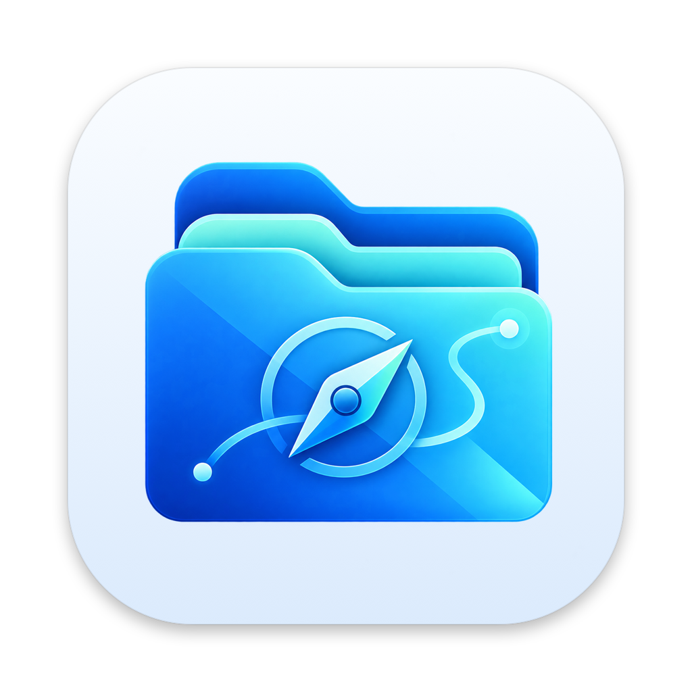

<p align="center"></p>

<h1 align="center">Wayfile</h1>

<p align="center">
A native macOS file manager for power users – tabs and dual panes, undo for everything,<br>
sync and compare, Git and Docker, remote storage, scripting and AI search. SwiftUI + AppKit, no Electron.
</p>

<p align="center">
<a href="LICENSE"></a>


</p>

Inspired by [Files](https://github.com/files-community/files) for Windows. The interface is available in English and Slovak.

## Highlights

**Navigation**
- Tabs in the title bar, dual pane (⌥⌘D) and quad pane, synchronized navigation, sessions restored on launch, named workspaces
- Omnibar with breadcrumbs and path autocomplete, folder tree, command palette (⇧⌘P), Vim mode, trackpad gestures
- Layouts: Details, List, Grid, Cards and Columns; grouping and per-folder view settings; themes, custom toolbar and remappable shortcuts

**Search**
- Instant filter and advanced search (name, contents, kind, size, date, tags, custom metadata, regex / glob) via Spotlight or a direct scan; saved searches and smart collections
- **AI search** – describe files in your own words; **Ask AI** about a file or folder. Models: Claude (Pro/Max or API), ChatGPT, Gemini, any OpenAI-compatible endpoint, Ollama, or Apple on-device models
- Duplicate finder, large and unused files, organisation suggestions

**File operations you can trust**
- Transfer engine on `copyfile` with APFS cloning, a queue per destination volume, pause / resume mid-file, retry, integrity verification after copy
- **Timeline** – persistent history of every operation; undo or redo any past entry, with safety checks if files changed since
- Transfers are journaled and resume after a crash or force quit
- Conflict resolution per item, dry-run previews, batch rename (regex, EXIF dates, numbering, live preview)

**Compare and sync**
- Directory diff, one-way update / mirror and two-way sync that remembers the last synced state, so deletions travel both ways and conflicts never lose data – previewed and undoable
- Side-by-side file diff; folder integrity monitor (baseline fingerprints)

**Previews and inspector**
- Quick Look, Markdown, JSON tree, hex, logs (live follow), code with syntax highlighting, media codecs, EXIF, archive contents, file versions
- Properties: recursive sizes, checksums (MD5 / SHA-1 / SHA-256 / SHA-512), POSIX permissions, ACLs, extended attributes, quarantine

**Developer tools**
- Git: status columns, branches, pull / push / fetch, stage / unstage / discard, commit, side-by-side diffs, history
- Project detection (Swift, Node, Python, Rust, Go, .NET, PHP, Docker, Make…) with runnable scripts; integrated terminal
- Docker explorer: containers by compose project, logs, shell, images, volumes

**Remote storage**
- SMB / AFP / NFS / WebDAV with Bonjour discovery, SFTP / SSH, S3 and compatible services (AWS, R2, B2, Wasabi, MinIO); credentials in the Keychain
- Cloud drives (iCloud Drive, Google Drive, OneDrive, Dropbox, Box) in the sidebar

**Scripting and automation**
- JavaScript with a permission-checked `wayfile` API, dry runs and undo; shell, Python, AppleScript, Apple Shortcuts and pipelines
- JavaScript runs in a separate sandboxed process (`wayfile-script-runner`)
- Folder triggers, schedules, rules (move / copy / tag / trash by name, kind, age, size), plugins with a native UI, shareable `.wayfilescript` packages – see [docs/Scripting.md](docs/Scripting.md)

**Disks and security**
- Disk usage treemap, archive browser and compression (ZIP with password, tar.*), links, encrypted vaults (AES-256 sparse bundles)

The full list and roadmap are in [`TODO.md`](TODO.md).

## Build and run

Requires macOS 14.4 or later and the Swift 6 toolchain – the Command Line Tools are enough, Xcode is optional.

```sh
scripts/build-app.sh          # release build → build/Wayfile.app
open build/Wayfile.app

swift run                     # quick dev run without bundling
scripts/selftest.sh           # self-test suite (800 checks): file ops, undo, sync, git, hashes, scripting, shortcuts…
scripts/make-icon.sh          # regenerate Resources/AppIcon.icns after changing logo.png
scripts/gen-scripting-docs.py # refresh the API tables in docs/Scripting.md after changing ScriptAPI
scripts/i18n.py               # pull new UI text into the translations (docs/Localization.md)
scripts/make-dmg.sh           # disk image for distribution
```

Debug-only environment variables: `WAYFILE_START=/path` opens the first window at a folder, `WAYFILE_NAVIGATE=/path` navigates after launch, `WAYFILE_LAYOUT=details|grid|columns`, `WAYFILE_PALETTE=1` opens the command palette, `WAYFILE_GROUP=kind` groups, `WAYFILE_PROPERTIES=/path` opens a Properties window, `WAYFILE_THEME=nord` applies a theme, `WAYFILE_SHORTCUT_TEST=1` checks live shortcut remapping in the real menu, `WAYFILE_SNAPSHOT=/out.png` renders every open window to PNGs after launch.

## Project layout

```
Sources/Wayfile/Models      file items, view settings, search queries, rules, themes, shortcuts
Sources/Wayfile/Services    copy engine, file operations, sync, search, Git, Docker, S3, SFTP, AI, scripting host
Sources/Wayfile/State       windows, panes, operation center, timeline
Sources/Wayfile/Views       SwiftUI / AppKit views
Sources/ScriptBridge        JavaScript engine shared by the app and the script runner
Sources/ScriptRunner        sandboxed JavaScript runner process
Tests/SelfTest              self-test suite
Resources/Localization      English and Slovak strings
```

## Status

Pre-release. Not yet signed with a Developer ID or notarized; see "Before a public release" in [`TODO.md`](TODO.md).

## Author

Developed by **Martin Pohorelský** ([martenech](https://github.com/martenech)).

## License

MIT, see [`LICENSE`](LICENSE). Dependencies: [SwiftTerm](https://github.com/migueldeicaza/SwiftTerm), [Citadel](https://github.com/orlandos-nl/Citadel) and [Yams](https://github.com/jpsim/Yams) (all MIT).
